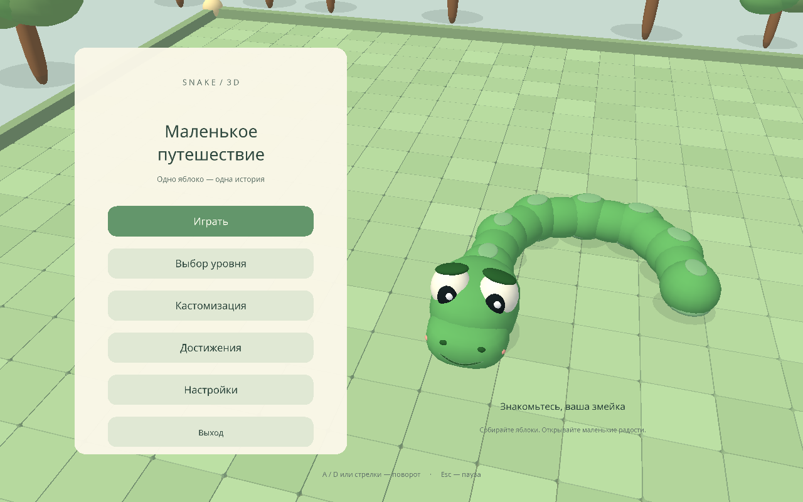
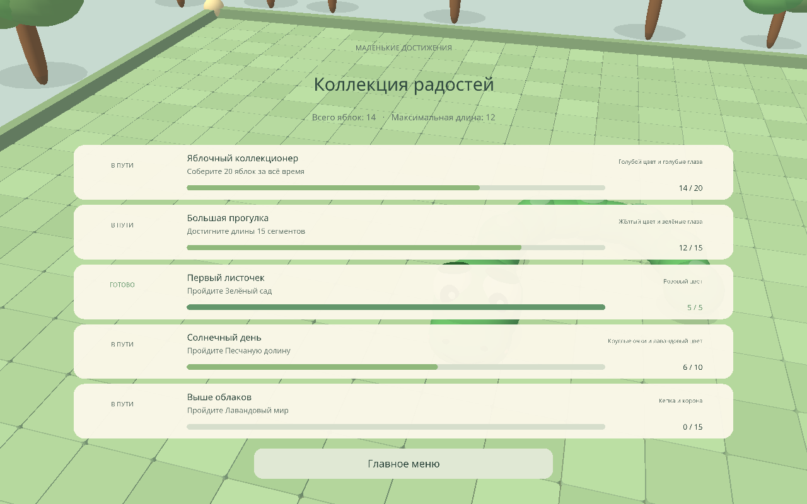
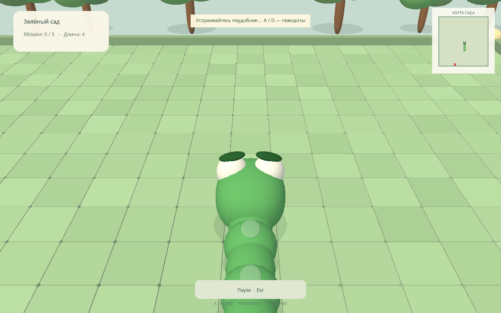

# Snake 3D · Маленькое путешествие

Полноценная настольная змейка на **Python + Panda3D** для лабораторной работы.
Камера следует за персонажем, а неподвижная мини-карта показывает всю арену.
Модели, скруглённый интерфейс и короткие звуки создаются программно. Blender не нужен.

**Готовая версия Windows без установки Python:** скачайте
[Snake-3D-v1.1-Windows.zip](https://github.com/ArishkaWolf/Snake-3D/releases/download/v1.1/Snake-3D-v1.1-Windows.zip),
полностью распакуйте и запустите `Snake3D.exe`. Сохраните `_internal` рядом с EXE.
Архив и материалы itch.io описаны в [инструкции распространения](docs/DISTRIBUTION.md).



## Установка и запуск в Windows

1. Установите **64-разрядный Python 3.11 или 3.12** с [python.org](https://www.python.org/downloads/windows/). При установке отметьте **Add python.exe to PATH**. Код также работает на Python 3.10; фактическая проверка выполнена на Python 3.10.7 x64.
2. Скачайте репозиторий или выполните `git clone https://github.com/ArishkaWolf/Snake-3D.git`.
3. Откройте PowerShell в папке проекта:

```powershell
python -m venv .venv
.\.venv\Scripts\python.exe -m pip install -r requirements.txt
.\.venv\Scripts\python.exe main.py
```

Активировать окружение и менять ExecutionPolicy не требуется. Единственная внешняя зависимость игры — **Panda3D 1.10.16**. Нужен рабочий графический драйвер OpenGL. После установки игра не использует сеть.

## Управление

| Клавиша | Действие |
|---|---|
| A / стрелка влево | Повернуть влево относительно головы |
| D / стрелка вправо | Повернуть вправо относительно головы |
| Escape | Пауза / продолжение / возврат из меню |
| R | Повторить после проигрыша или победы |

На русской раскладке также принимаются Ф, В и К. Змейка движется сама.
За один логический шаг принимается один поворот. Быстрое двойное нажатие не разворачивает змейку на 180°.
При потере фокуса игра ставится на паузу. После старта есть 1,5 секунды на подготовку.

## Что есть в игре

- Арена 20×20, соединённое округлое тело, большая голова с глазами, улыбкой, ноздрями и щёчками.
- Плавная интерполяция тела и камера с настройкой расстояния.
- Красное яблоко с черенком и листиком, рост, искры и звуки подбора.
- Столкновения со стенами, телом и камнями во втором мире.
- Три последовательных мира и бесконечный режим «Без спешки».
- Русские меню: выбор мира, пауза, победа, проигрыш, настройки, достижения и кастомизация с 3D-предпросмотром.
- Пять цветов тела, три цвета глаз, очки, кепка и корона. Очки можно сочетать с головным убором.
- Пять достижений с полосами и счётчиками прогресса, личные рекорды, постоянный прогресс, подтверждение сброса.
- Семь звуковых эффектов, включая подбор яблока, отдельные столкновения со стеной и телом.
- Оригинальная спокойная музыка с настроением пост-рока и отдельный ползунок громкости.

| Мир | Яблок для победы | Шагов в секунду | Награда |
|---|---:|---:|---|
| Зелёный сад | 5 | 3,4 | Розовый цвет |
| Песчаная долина | 10 | 3,9 | Очки и лавандовый цвет |
| Лавандовый мир | 15 | 4,5 | Кепка и корона |
| Без спешки | Без ограничения | 3,6 | Личный рекорд |

За 20 яблок за всё время открываются голубые тело и глаза. За длину 15 — жёлтое тело и зелёные глаза.
Повторное прохождение доступно, уже выданные награды повторно не выдаются.
В достижениях видно, сколько осталось до цели. Для прохождения мира учитывается
лучший результат за одну попытку, для коллекции яблок — сумма за всё время.





## Сохранения

Основной профиль: `%LOCALAPPDATA%\Snake3D\save.json`.
Если LOCALAPPDATA отсутствует, используется `~/.local/share/Snake3D/save.json`.
В папку установки ничего не записывается. Каждое яблоко сохраняет статистику; завершение,
перезапуск, выход в меню и закрытие окна сохраняют рекорд. Образ сохраняется при выборе,
настройки — при закрытии настроек или приложения.

Запись атомарная: временный файл → `os.replace`. Повреждённый JSON сохраняется рядом как
`save.corrupt-ДАТА.json`, создаётся новый профиль. Неверные типы полей нормализуются.
При ошибке доступа интерфейс сообщает о проблеме; текущая игра продолжает работать в памяти.
Сброс доступен в настройках после отдельного подтверждения.

Для отдельного тестового профиля:

```powershell
.\.venv\Scripts\python.exe main.py --save-path artifacts\manual-save.json
```

## Проверки

```powershell
.\.venv\Scripts\python.exe -m pip install -r requirements-dev.txt
.\.venv\Scripts\python.exe -m pytest -q
.\.venv\Scripts\python.exe -m compileall -q main.py config.py game tests tools
.\.venv\Scripts\python.exe tools\smoke_test.py
.\.venv\Scripts\python.exe tools\smoke_test.py --windowed
```

`pytest` проверяет чистую логику без графического окна. Интеграционная проверка использует
настоящий рендерер Panda3D, временный профиль, проходит три мира обычными ходами,
проверяет меню, сохранения, награды, паузу, камеру, разные размеры окна и удаление сцен.
Она создаёт PNG и JSON-отчёт в `artifacts/`. В ходе проверки счёт и награды не подменяются.
Тестовый автопилот из `tools/autoplay.py` не включается в обычной игре.

Итоги и ограничения проверки: [docs/TEST_REPORT.md](docs/TEST_REPORT.md).
Ручной сценарий: [docs/MANUAL_TESTING.md](docs/MANUAL_TESTING.md).

## Сборка Windows

```powershell
.\build_windows.ps1
```

Если политика PowerShell запрещает скрипт, можно вызвать сборщик напрямую:

```powershell
.\.venv\Scripts\python.exe -m PyInstaller --noconfirm Snake3D.spec
```

Результат: `dist\Snake3D\Snake3D.exe`. Передавать нужно **всю папку Snake3D**, включая `_internal`.
Python на компьютере получателя не нужен. EXE не подписан цифровой подписью.
Подробности: [docs/BUILD_WINDOWS.md](docs/BUILD_WINDOWS.md).
Сборка и временные результаты исключены из Git.

## Структура

```text
main.py                   точка входа и параметры диагностики
config.py                 размеры, камера, палитра, пути
game/
  app.py                  состояния приложения и цикл времени
  snake.py                чистая логика сетки и интерполяция
  levels.py               данные миров
  world.py                плитки, бортики, деревья, кактусы и лаванда
  geometry.py             процедурные сетки и скруглённые UI-панели
  customization.py        голова, тело и аксессуары
  camera.py               плавное слежение
  food.py                 яблоко и эффект подбора
  minimap.py              2D-карта на CardMaker
  quests.py               условия достижений и награды
  save_manager.py         JSON, валидация, атомарная запись
  resources.py            загрузка ресурсов через VFS, Unicode-пути
  audio.py                синтез WAV и воспроизведение
  ui.py                   DirectGUI
assets/                   шрифт с лицензией и WAV
tests/                    автоматические тесты логики
tools/                    интеграционная диагностика и тестовый автопилот
```

Скорость и цели меняются в `game/levels.py`, камера и палитра — в `config.py`.
Звуки можно заново получить вызовом `generate_sounds('assets/sounds')` из `game.audio`.
Музыкальная петля Little Journey (48 секунд, 80 BPM) создаётся командой
`python tools/compose_music.py`. Генератор использует только стандартную библиотеку;
игра проигрывает готовый стерео WAV без синтеза во время игры. Громкости эффектов
и музыки сохраняются независимо. На паузе музыка плавно приглушается.
Текстуры не требуются: `assets/textures/README.md` объясняет выбор процедурных материалов.

## Лицензии и источники

Код, модели и синтезированные звуки: [MIT](LICENSE). Шрифт Noto Sans: [SIL OFL 1.1](assets/fonts/OFL.txt).
Полный список: [THIRD_PARTY.md](THIRD_PARTY.md). Пользовательский референс использован как идея
крупной мультяшной головы; изображение и чужие игровые модели в поставку не входят.

Официальные источники: [Panda3D 1.10.16 / PyPI](https://pypi.org/project/Panda3D/1.10.16/),
[руководство Panda3D](https://docs.panda3d.org/1.10/python/),
[PyInstaller: режим папки](https://pyinstaller.org/en/stable/operating-mode.html).
